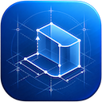

- **Multi-sheet drawings**: extra sheets with their own views, dimensions, callouts and title block; sheet tabs in the panel, and PDF export writes one page per sheet.
- **Tolerance callouts** place a feature-control frame with a leader on a drawing view; the frame text is editable in the panel and exports with PDF/SVG/DXF.
- **Manual dimensions** on drawings: the Dimension tool snaps to projected vertices and places an aligned linear dimension with its true model length; dimensions are listed and deletable in the drawing panel.
- **Contact sets** group components so moving one (by drag, gizmo or its properties) moves the whole set together.
- **Exploded views** can be played back with the Play explode button, and their drawings mark the isometric view as EXPLODED.
- **Fusion interaction**: the Line tool can continue into tangent arcs from its options (Line / Tangent Arc), and command panels float as draggable dialogs over the graphics area instead of taking the left pane.
- **Fusion workflow**: Extrude and Revolve list each closed sketch region as a Profile checkbox, finishing a sketch leaves it selected as the next profile, and double-clicking a component in an assembly activates its part for in-place editing (Finish Part returns to the assembly).
- The ribbon follows Fusion 360: a **Solid** tab with Create / Modify / Construct / Insert groups, a **Sketch** tab with Create / Modify / Constrain / Dimension / Finish groups, and a separate **Assembly** tab (shown only for assemblies).
<p align="center"></p>

<h1 align="center">Parametric</h1>

<p align="center"><strong>Live app:</strong> <a href="https://parametric.puter.com/">parametric.puter.com</a></p>

<p align="center">Feature-based parametric 3D CAD in the browser. An open-source alternative to SolidWorks, Autodesk Fusion and Autodesk Inventor.</p>

> **Early alpha.** Features may change and work could be lost. Please do not rely on Parametric for production designs yet, and keep a downloaded copy of anything important.

Parametric models solid parts and assemblies the way mechanical engineers expect: you draw constrained 2D sketches on planes or faces, turn them into editable 3D features, place finished parts in an assembly, and create engineering drawings with an optional bill of materials. Change a dimension and the affected part rebuilds.

It runs entirely in the browser. The geometry kernel is OpenCascade compiled to WebAssembly, running in a Web Worker so the interface never freezes. Storage, sign-in and settings use [Puter](https://puter.com); you can also work without an account, in which case parts are kept in your browser.

## Features

**Sketching**
- Lines, centerlines, corner, center and three-point rectangles, circles (center or 3 points), arcs (centerpoint, tangent, 3 point), polygons, straight, overall and center-point slots, splines and points.
- Inference while drawing: snapping to points, midpoints, curves and the origin, horizontal and vertical directions, and alignment guides. Matching relations are added automatically.
- Geometric constraints (relations): coincident, horizontal, vertical, parallel, perpendicular, tangent, equal, concentric, midpoint, collinear, symmetric and fix. Pick one in the Constrain group of the Sketch tab and click the geometry it applies to, or select geometry first and choose from the constraints that fit.
- Smart Dimension: distances (aligned, horizontal, vertical), point to line, parallel lines, angles, radius and diameter, chosen from what you select and where you place the label. Driven (reference) dimensions.
- The dimension edit box can bind a driving dimension directly to an fx parameter; choosing a parameter writes `=Name`, and switching part configurations re-solves the sketch at each configured value.
- A constraint solver with live dragging and definition status: blue geometry can still move, black is fully defined, red conflicts. The status bar shows the remaining degrees of freedom.
- Sketch fillet, trim, extend, offset, mirror, construction geometry.
- A planar grid on the sketch plane and on visible reference planes, with a spacing that adapts to the zoom. Turn it on or off under **View › Hide/Show › Grid**, and snap points to its crossings from the sketch palette.
- External geometry: Convert Entities projects model edges, faces and vertices into the sketch, and a sketch point or curve can be constrained to a model edge or vertex directly. Projected geometry stays linked to the model: when an earlier feature changes, it moves with the model and the sketch geometry constrained to it follows.

**Features**
- Extruded boss and cut (blind, through all, mid plane, two directions, draft).
- Feature value fields can be linked directly to an fx parameter from their dropdown; the stored value becomes an expression such as `=Width`.
- Revolved boss and cut (full or partial, mid plane).
- Swept and lofted boss and cut.
- Fillet, chamfer (equal distance, two distances, distance and angle), shell, draft.
- Holes: simple, counterbore, double counterbore, countersink, counterdrill, spotface and tapped, with a Fusion-style workflow that confirms positions before previewing. The Positions panel supports exact X/Y coordinates, face-centre holes and snapping to edges, vertices and circular-edge centres. A hole can end at a distance, through the body, or at a selected planar face (**To Object**).
- Linear patterns (one or two directions), circular patterns and mirroring.
- On-model value handles: a plane's offset, an extrusion's depth, a revolve's angle, a fillet's radius and a chamfer's distance can be dragged or typed directly beside the geometry, Fusion-style, and the PropertyManager field follows the handle.
- Reference planes, matching Fusion's construction plane types: offset from a plane or face, halfway between two parallel references (midplane), at an angle about an edge lying in the plane, tangent to a cylindrical, conical or spherical face (at a picked vertex, or the face centre), through two straight edges, and through three points. The offset and angle can be edited on the model with the value handle. STEP import.
- Reference axes and points, like Fusion's construction geometry: an axis along a cylindrical/conical face, through two points, along a straight or circular edge, or perpendicular to a plane through a point; a point at a vertex, an edge midpoint, a circle centre, a face centre, or where a straight edge meets a plane. Axes and points are drawn in the view, kept in the design tree and can be used as references.
- **Sketch on This Plane** starts a sketch straight on the selected reference plane or planar face (also in the right-click menu), without the extra plane pick.
- Open SolidWorks parts (.sldprt, SolidWorks 2003 and later) without SolidWorks: the exact solid is read from the file and becomes an imported body you can keep modeling on. The SolidWorks feature tree is not carried over.
- References to faces and edges are stored by name, so fillets and sketches on faces survive dimension changes.

**Data and reusable parts**
- Local Project Manager: organise browser-saved parts into named projects and, in the desktop app, bind a project to a real local folder. Double-click a project folder to make it current; new parts then get a destination in that folder, with manual Save or optional automatic saving.
- Parameter configurations: define named overrides for any fx parameter with values or expressions, then switch the active configuration to rebuild the part at another size.
- Part Resource Center: publish parameterized parts with their fx parameters and configurations, browse by category or parameter, and open independent copies from the library.

**Assistant**
- An AI design assistant in the right sidebar (Ctrl+J, or the sparkle button). Describe a part or a change ("a 100 × 60 × 8 mm plate with four M5 holes and rounded corners", "make the wall 3 mm", "fillet the top edges") and it builds it with the same features you use: sketches with exact geometry, relations and dimensions, extrudes, revolves, holes, fillets, chamfers, shells, patterns, mirrors, planes, lofts, sweeps and drafts, global variables and equations.
- It reads the part precisely (feature parameters, sketch entities, faces and edges by name, measurements, mass properties), checks every change by rebuilding, undoes steps that would break a feature, and looks at the model to verify its work.
- Attach files to a message (paperclip, paste or drop): photos and sketches of a part, dimensioned drawings and datasheets as images or PDFs, DXF outlines or CSV tables. It reads sizes and geometry from them.
- Everything it changes in one message is a single undo step. It runs on Puter AI (Claude Opus 5.5).

**Mechanical**
The **Mechanical** tab holds the power-transmission generators. Every generator rebuilds its solid as you type and reports its sizing next to the fields, using power, speed, the service factor and the material (45 steel, 40Cr, 20CrMnTi, cast iron, 6061 aluminium or a custom allowable stress).
- **Shaft**: a stepped shaft from a segment table (diameter and length), 45° end chamfers and an optional keyway; checks the design torque, minimum diameter and the torsional stress of every segment.
- **Spur Gear**: an involute gear from module, tooth count, pressure angle, face width, bore and optional hub; reports the pitch, base and outer diameters, tangential force, pitch-line velocity and the Lewis tooth bending stress against the material.
- **Bevel Gear**: a straight bevel gear on a 90° shaft angle from the module and the two tooth counts; the teeth are lofted from the back cone to the front so they converge on the apex, and the panel checks the face width against the cone distance and the tooth bending stress.
- **Worm Gear**: the worm and its wheel at the centre distance that follows from the module and the worm diameter; the worm thread is swept around a helix, the wheel gets its throat, and the panel reports the ratio, lead angle and sliding speed.
- **V-Belt Drive**: two sheaves with V grooves and the belt around them; reports the ratio, belt length, wrap angle on the small pulley, belt speed and design torque.
- **Synchronous Belt**: two timing pulleys with trapezoid teeth and the belt around them; reports the pitch diameters, belt length in pitches, teeth in mesh and belt speed.
- **Sprocket**: a roller chain sprocket from the chain pitch, tooth count and roller diameter; reports the pitch, outer and root diameters, chain speed and tangential force.

**Drawings**
- A 2D drawing sheet for each part or assembly (Drawing tab in the status bar): front, top, right, left, back, bottom and isometric views projected from the solid, with hidden lines and overall dimensions.
- Section views cut the model along X, Y or Z at an offset from its centre (seen from either side) and hatch the cut face; the sheet letters them A-A, B-B and so on.
- **Auxiliary views** look square on at a picked planar face (the face's normal is the view direction).
- **Detail views** magnify a circular window of another view (centred on a hole when there is one), clipped to the window and labelled DETAIL A (2:1) with the window's circle drawn.
- Each view can take its own scale; the selected view's controls (hidden lines, dimensions, section plane, detail window, scale) open in the drawing panel.
- Centre marks on the circular holes facing a view, and numbered balloons for assembly drawings that match the bill of materials.
- Title block carries the drawing number and revision beside the title, scale, material, units, date and author.
- Drawings export to PDF, SVG and DXF (named layers: VIEW, HIDDEN, DIM, TEXT, BORDER, BALLOON).
- Sheet sizes A4 to A1, Letter and Tabloid, standard scales, drag to arrange views, title block.
- Assembly drawings include an aggregated bill of materials with item number, part, description (from the part drawing's title), quantity and material.
- Export to PDF or SVG.

**Assemblies**
- Create a new assembly and insert saved `.parametric` parts as independent components, by the picker or by dragging a part file onto the assembly.
- **Component patterns** copy components around an axis or along up to two directions; the copies are built as part of the assembly, light up with their seed and count in the bill of materials.
- **Replace Component** swaps a component's part file while keeping its position, name and joints.
- **Duplicate Component** copies the selected components beside the originals and selects the copies.
- **Exploded View** pushes every component away from the assembly centre; the viewport and the drawings show the exploded state.
- **Fix/Float** toggles one component, and grounds (or floats) all of several selected components at once.
- **Isolate** hides every other component and **Show All Components** brings them back. A saved assembly can be inserted as a sub-assembly: it is built from its parts and moves as one unit until it is opened for editing.
- **New Part** in an assembly creates an empty in-place part and opens it for sketching and modeling; **Finish Part** writes it back into the component, and a double-click on a component opens its part again.
- The assembly design tree shows every component; component properties edit its name, visibility, XYZ position and XYZ rotation, with full undo/redo.
- Pick a component in the view (a click selects the whole component, highlighted as one part) or in the design tree; Ctrl-click adds to the selection.
- **Move/Rotate** shows a three-axis handle on the selected components: drag the X, Y or Z arrow to move along that axis, drag the part itself to move it freely, hold Shift while dragging to rotate it, or type X/Y/Z offsets and a rotation about X, Y or Z. A component joined to another moves by its joint value instead, and dragging it slides or turns the joint within its limits. The whole drag is one undo step.
- **Joint**: select two components, pick a face, an edge or the origins on each, and the driven part snaps into place with the picked geometry meeting the reference (mated faces, coaxial edges or coincident origins). Joints are rigid, revolute, slider, cylindrical, planar, ball or pin-slot; cylindrical, planar, ball and pin-slot joints expose a second axis and value with independent motion limits.
- Every joint made between picked geometry stores where it was made, so moving the reference component carries the joined parts with it, and the joint value drives the motion from there.
- **Smart fits**: right-click a component for Move/Rotate, Auto Mate, Joint, Mate Suggestions and Fix/Float, or right-click a face or edge for "Auto Mate This Face" and "Joint From This Geometry". Auto Mate constrains the best-fitting geometry it finds on its own, the Joint panel preselects the best fit (touching faces, parallel faces or shared axes) and lists the other candidates, and Mate Suggestions shows every fit with an Apply button, worst last.
- **Assembly Mate** and **Joint** are the same constraint now: both pick a face, an edge or the origins on the two parts, so there is one kind of assembly constraint to learn. Old origin/axis mates still open and solve, and their editor points to the joint workflow.
- A jointed component dragged in Move stops at its joint limits and snaps to them (also to zero and whole degrees/millimetres), and the allowed travel is drawn in the view while the joint is being moved.
- The motion study panel drives primary and secondary joint values interactively or plays the primary value back in a continuous loop without adding simulation frames to Undo.
- Run a B-Rep interference check between every pair of visible components and report the exact overlap volume.
- Run Assembly Diagnostics to find fixed-fixed mate conflicts, joints driving grounded parts, missing references, invalid secondary ranges and assemblies without a grounded component.
- Each component keeps its own feature tree, expressions, material and imported geometry. The assembly rebuilds the placed parts independently, applies the rigid transform and exports the result as a multi-solid STEP or STL.
- Assembly drawings and PDF/SVG exports use the same hidden-line projection pipeline as part drawings.

**Working with parts and assemblies**
- Design tree with rollback bar, suppress, rename, hide/show, edit and delete with dependency warnings.
- Global variables and equations: type `=Width/2` in any dimension or feature value.
- Material and appearance, mass properties (mass, volume, area, center of mass, inertia), measure, section view.
- Display styles (shaded with edges, shaded, hidden lines removed or visible, wireframe), standard views, perspective.
- Save to your Puter cloud or this browser, crash recovery of unsaved work, export STEP and STL, download the part file.
- Open parts, STEP and SolidWorks files from the Puter desktop (double-click or Open with), or drag them onto the app from a Puter folder window or your computer. Files dragged onto the assistant go with your next message.
- Share parts saved in your Puter cloud with other Puter users, with view or edit access. Parts shared with you appear under **Shared with me** in the Open dialog.
- Undo and redo for everything, including sketch edits.
- Light, dark and system themes. Works with mouse, trackpad, touch and keyboard, from phones to large desktop screens.
- Simplified Chinese is the default interface language. English is available under Options › Interface language.

## Using it

1. Pick **Front Plane** (or any plane or flat face) and click **Sketch**.
2. Draw with the sketch tools, then add dimensions with **Smart Dimension** (D).
3. Click **Extruded Boss** (or another feature). The finished sketch becomes the profile. Drag the value box on the model, or type into it, to set the depth or radius and watch the preview update.
4. Double-click a feature in the tree, or a face in the graphics area, to change it.

Navigation: middle or right drag rotates, Ctrl + middle drag or Shift + right drag pans, the wheel zooms at the cursor, F fits the view, Ctrl+1 to Ctrl+8 select standard views and Space opens the view orientation menu. On touch screens, drag with one finger to rotate and use two fingers to pan and zoom. Press F1 for all shortcuts.

## Development

```sh
npm install
npm run dev        # http://parametric.puter.localhost:5581/
npm test           # unit and kernel tests (Vitest)
npm run test:e2e   # browser tests (Playwright, software WebGL)
npm run build      # type check, license check, production build in dist/
npm run i18n:extract && npm run i18n:dict && npm run i18n:check
```

## Windows desktop and automatic updates

Build the Windows installer with:

```sh
npm run desktop:build
```

The installer and update metadata are written to `desktop-release/`:

- `Parametric-Desktop-Setup-0.4.3.exe` — per-user NSIS installer, with install-directory selection and desktop/start-menu shortcuts;
- `latest.yml` — the update manifest read by `electron-updater`;
- `Parametric-Desktop-Setup-0.4.3.exe.blockmap` — differential download data.

An installed copy checks for updates eight seconds after startup, downloads a newer version in the background and asks whether to restart and install. **Help → Check for updates…** runs the check manually.

The source repository is also the update source: `electron-builder` publishes the installer, `latest.yml` and the `.blockmap` as GitHub Release assets for `salien-zsh/parametric`. Every push to `main` that changes the application runs `.github/workflows/parametric-desktop-release.yml`; the workflow tests the source, chooses the next patch version, builds the installer and publishes `parametric-v<version>` as the latest GitHub Release. Installed clients then discover that release through `electron-updater`.

The workflow requires repository workflow permissions to write GitHub Releases. It uses the built-in `GITHUB_TOKEN`; no PAT is needed in normal CI use. A manual run is available from **Actions → Parametric desktop release → Run workflow**.

Publishing locally requires a GitHub token with release permission:

```sh
$env:GH_TOKEN="github_pat_..."
npm run desktop:publish
```

To use a different update server, set `PARAMETRIC_UPDATE_URL` in the installed app's environment. It overrides the packaged GitHub release feed. Increment `package.json` `version` for every release; clients only accept a higher version.

For distribution without Windows SmartScreen warnings, configure code signing through electron-builder's `CSC_LINK` and `CSC_KEY_PASSWORD` environment variables. The current locally produced installer is unsigned.

### Architecture

| Area | Where | Notes |
|---|---|---|
| Document model | `src/model` | Plain JSON parts: features, sketches, variables. Undo/redo by snapshots. Parameters may be expressions. |
| Assembly model | `src/model/document.ts`, `src/model/assembly.ts`, `src/app/assembly.ts` | Assemblies embed portable part documents plus rigid placement; joints made between picked geometry store a relative placement so the driven part follows its reference, and components, mates and joints are undoable document data. |
| Sketch solver | `src/sketch/solver.ts` | Minimum-norm damped Gauss-Newton per independent cluster, with a rank analysis for degrees of freedom and redundant or conflicting constraints. |
| Profiles | `src/sketch/profiles.ts` | Planar face finding on the sketch graph; nested loops alternate material and holes. |
| Geometry kernel | `src/kernel` | OpenCascade (WebAssembly) in a Web Worker. Each feature is cached under a hash of everything before it, so edits rebuild only what changed. Faces are named after the feature and sketch entity that created them. |
| Renderer | `src/render` | WebGL2: shaded meshes with per-face state in a data texture, screen-space thick edges, GPU picking with depth (asynchronous readback for hover), section clipping, render on demand. |
| Interface | `src/app`, `src/ui` | No framework. CommandManager, design tree, PropertyManager panels, sketch editor, dialogs. |
| SolidWorks import | `src/formats/sldprt` | Reads the SolidWorks container (2015+ chunk format and the older OLE2), decodes the embedded Parasolid transmit and writes it as exact STEP for the kernel. Runs in the geometry worker. |
| Assistant | `src/assistant` | Tool-calling agent on Puter AI. Tools work on the document through a host interface (the app, or the kernel in Node for tests); each change rebuilds and is checked, failing steps are reverted, and a message's changes are squashed into one undo step. |
| Platform | `src/platform` | Puter.js access, files (Puter or browser storage), theme. |

Settings are kept in a single key-value entry; part files are stored as files, never in the key-value store.

## License

Parametric is licensed under the [GNU Affero General Public License v3.0](LICENSE). Third-party libraries retain their own licenses.

Third-party components and their licenses are listed in [public/licenses/THIRD_PARTY_NOTICES.txt](public/licenses/THIRD_PARTY_NOTICES.txt); the OpenCascade kernel is LGPL-2.1 and ships as a separate, replaceable WebAssembly module.
